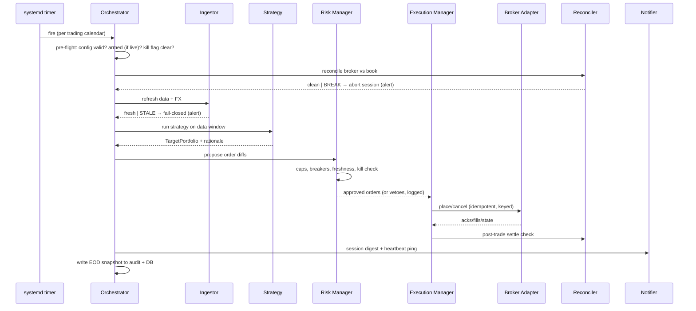

# System Architecture

| | |
|---|---|
| **Document ID** | DOC-016 |
| **Version** | 0.1 (Draft) |
| **Owner** | Founder |
| **Date** | 2026-10-27 |
| **Related** | [SRS](../03-requirements/01-software-requirements-specification.md) · [Tech Stack](02-tech-stack.md) · [Broker Adapter Spec](03-broker-adapter-specification.md) · [ADR index](adr/README.md) |

## 1. Design Philosophy

1. **One code path.** Backtest, paper, and live run the same event-driven core
   with swappable data/broker drivers ([ADR-003](adr/ADR-003-single-codepath-event-driven-core.md)).
   "Backtested is what you trade" is a property of the code, not a discipline.
2. **Fail-closed everywhere.** The system's default answer to uncertainty is
   *don't trade, tell someone* (§7, INV-1).
3. **The risk gate is structural, not procedural.** No code path from signal to
   order bypasses risk approval (INV-2) — enforced by module boundaries and
   types, verified by tests.
4. **Boring, inspectable state.** Files, SQLite, JSONL logs. Everything a human
   can read with standard tools; everything reproducible from artifacts.
5. **$0-shaped.** Single host, no message brokers, no clusters, no paid
   services. Complexity is only added by documented failure demand.

## 2. Component Architecture

```mermaid
flowchart TB
  subgraph Core["Engine core (single Python process per session)"]
    ORCH[Orchestrator\nsession state machine]
    ING[Data Ingestor\nvalidation + staleness]
    FEED[Data Window\npoint-in-time views]
    ST[Strategy\npure function]
    RISK[Risk Manager\npre-trade gate + breakers]
    OM[Execution Manager\nOMS + idempotency]
    PF[Portfolio Accounting\nACB, P&L, CAD]
    RC[Reconciler\nbroker vs book]
    AU[Audit Writer\nappend-only, hash-chained]
  end
  subgraph Infra["Host services"]
    TIM[systemd timer]
    NOT[Notifier service\nTelegram listener + digest]
    KSDB[(Kill-switch flag\n+ breakers state)]
    DB[(SQLite WAL)]
    COLD[(Parquet cold store)]
  end
  subgraph Drivers["Swappable drivers (ADR-002/004)"]
    AD[Broker Adapter\nAlpaca paper | Wealthsimple]
    DS[Data Source\nStooq | yfinance | Alpaca | BoC]
  end

  TIM --> ORCH
  DS --> ING --> COLD
  COLD --> FEED
  ORCH --> ING & ST & RC & PF
  FEED --> ST -->|TargetPortfolio| RISK
  RISK -->|ApprovedOrder| OM
  OM <--> AD
  AD -->|fills| PF --> DB
  AD -->|positions| RC
  RC --> DB
  NOT <--> KSDB
  KSDB -.->|checked every phase + pre-order| ORCH
  NOT -->|alerts/digests| Operator
  AU -.records.-> ORCH & ING & ST & RISK & OM & RC & PF
```

## 3. Component Responsibilities

| Component | Responsibility | Key requirements |
|---|---|---|
| Orchestrator | Session state machine: pre-flight → data → signal → risk → orders → report; holds the only write transaction; checks kill switch between every phase | FR-CF, INV-1/6 |
| Data Ingestor | Fetch, validate, upsert bars/FX; provenance; staleness marking | FR-DA-01…04 |
| Data Window | Point-in-time, lookahead-safe views for strategies and backtests | FR-BT-03/04 |
| Strategy | Pure decision function: data window + config → `TargetPortfolio` + rationale | FR-ST-01…06 |
| Risk Manager | Pre-trade caps, breakers, kill state, freshness gate; **veto authority** | FR-RK-01…09, SEC-13 |
| Execution Manager | Order lifecycle, idempotency keys, retry taxonomy, rate limits, state mapping | FR-EX-01…08 |
| Broker Adapter | Broker-specific REST translation; capability flags; contract-tested | [Adapter spec](03-broker-adapter-specification.md) |
| Portfolio Accounting | Book of record, per-lot ACB, P&L, CAD translation | FR-PF-01…06 |
| Reconciler | Broker-vs-book diffs; hold-state management | FR-RC-01…04 |
| Audit Writer | Append-only, hash-chained event log | FR-AU-01…03 |
| Notifier | Long-running service: Telegram listener (commands), alerts, digests, heartbeat pings | FR-NT-01…04 |

## 4. Daily Session Sequence



## 5. Module Boundaries & Dependency Rules

| Rule | Enforcement |
|---|---|
| R1: Strategies are pure — no I/O, no clock, no RNG | Interface types + UT double-replay (FR-ST-02) |
| R2: Only adapters import broker SDKs/APIs; core is broker-agnostic | Import-lint in CI (ADR-002) |
| R3: Execution accepts **only** `ApprovedOrder` objects minted by the risk manager | Type-level boundary; constructor requires `RiskApproval`; property tests attempt bypass |
| R4: All external input crosses pydantic schemas before use | Contract tests + review (SEC-11) |
| R5: Audit is append-only; nothing reads it for decisions | Module design + review (AU-03 integrity) |
| R6: Kill switch is readable via a trivial local check at every phase boundary and pre-order | Orchestrator tests (FR-RK-04) |
| R7: One writer of trading tables (the session process); the notifier writes only its own flags/log | SQLite WAL discipline (§6) |

## 6. Process & State Model

- **Session process** — one-shot, timer-invoked, owns the trading-transaction
  stream; exit code reflects outcome; crash-safe resume via idempotency keys
  (NFR-06).
- **Notifier service** — long-running systemd unit; Telegram listener, alert
  sender, heartbeat pings; sets the kill flag on `/kill` (a plain local file +
  DB marker the session reads); never places orders.
- **State** — SQLite in WAL mode: crash-safe, one-writer (R7), trivially backed
  up (OPS-10). Parquet for cold market data. JSONL audit files with a daily
  hash-chain head replicated off-host (SEC-16).
- **Time** — all storage in UTC; wall-clock only at the orchestrator boundary;
  strategies receive injected timestamps (FR-ST-02).

## 7. Fail-Closed Philosophy

Every uncertainty resolves to *no new orders + an alert*. The table below is
the authoritative behavior specification (implements INV-1/6):

| Failure / condition | Behavior |
|---|---|
| Config invalid (schema or sanity) | Exit non-zero before any trading action (FR-CF-01) |
| Live mode not armed | Exit with no orders + alert (FR-EX-08) |
| Data stale, missing, or quality-check failure | Dependent decisions skipped; symbols marked stale (FR-DA-02/03, FR-RK-07) |
| FX rate missing for date | Use last prior official rate, log substitution (Data Req §4) |
| Reconciliation break (pre-session) | Session aborts, no orders, alert with diff (FR-RC-01) |
| Reconciliation break (EOD) | Next session held until manual resolve (FR-RC-02) |
| Broker unreachable / auth failure | No orders; bounded retries; alert; session marked degraded |
| Order timeout / unknown state | Query by idempotency key before anything else; halt new orders until resolved (FR-EX-03/04) |
| Risk check failure | Veto logged; order never submitted (FR-RK-01) |
| Circuit breaker trip (loss/drawdown) | Entries halted per breaker rules (FR-RK-02/03) |
| Kill flag set | Block entries, cancel rests, optional flatten (FR-RK-04) |
| Notification failure | Trading continues; failure visible in logs + heartbeat (FR-NT-04) |
| Host reboot mid-session | Next timer run resumes via idempotency; duplicate orders impossible (NFR-06) |
| Any unhandled exception in session | Caught at orchestrator top level → fail-closed + alert + audit entry |

**Design note:** downtime costs *opportunity*, never *safety* — the worst
outcome of any failure above is a flat (cash) account that didn't trade.

## 8. Deployment View

Single Linux host ([ADR-005](adr/ADR-005-zero-cost-hosting.md)): systemd timer
drives sessions; systemd service runs the notifier; Tailscale-only admin; no
inbound ports. Three profiles (dev/paper/live) = three config+credential+DB
sets, same binary (OPS-01). Full procedures: [Deployment & Environments](../06-operations/01-deployment-and-environments.md).

## 9. Constraints Recap (from SRS §7)

$0/month fixed cost · single host · Python 3.12+ · official broker APIs only ·
free/OSS dependencies with verified licenses · solo-maintainable.

## 10. Evolution Triggers (and non-goals)

| Trigger | Evolution | Status |
|---|---|---|
| DB > ~5 GB or concurrent readers needed | SQLite → Postgres (Supabase free tier or same-host) | Documented in [ADR-006](adr/ADR-006-storage-sqlite-first.md); not before P4 |
| Paper + live contention on one host | Second host for paper | Not planned pre-P4 |
| Multi-account support | Registration analysis + major refactor | **Blocked by RL-1** until P4 counsel |
| Message queue / microservices | — | **Non-goal** for this system class; the single-writer orchestrator is a feature |
| Web UI | — | Non-goal for MVP ([Product Overview §6](../02-product/01-product-overview.md)) |
